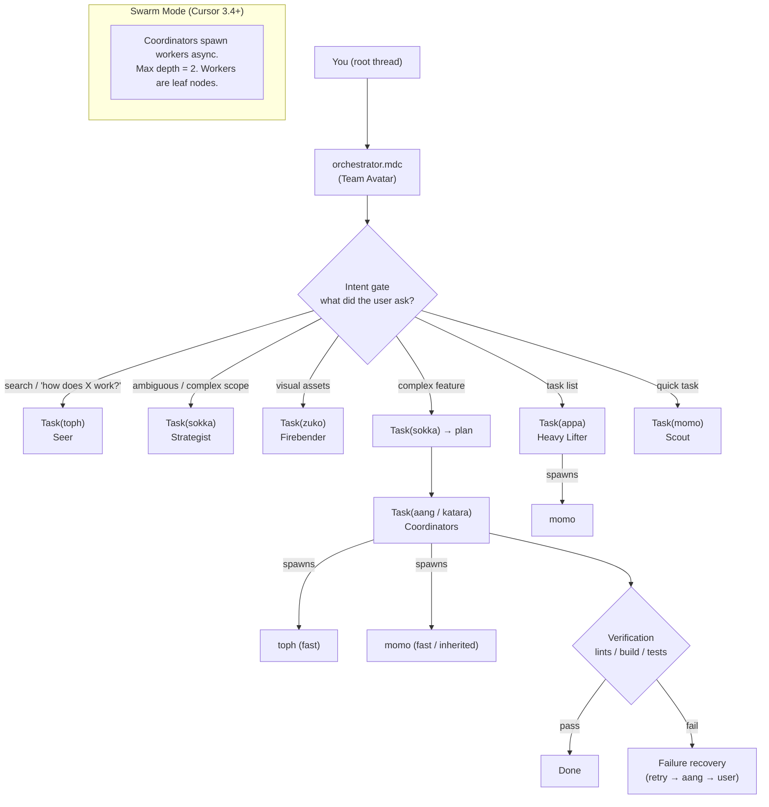

<div align="center">

<p align="center">
  <a href="https://github.com/tmcfarlane/team-avatar">
    
  </a>
</p>
<div style="font-size: 2.5em; font-weight: 700; letter-spacing: 0.12em;">
  <strong>TEAM AVATAR</strong>
</div>

**A universal agent orchestrator for Claude Code, Codex, and Cursor.**<br>
Nine characters from *Avatar: The Last Airbender*. 58 engineering skills. One mode that routes the work.<br>
_Created by <a href="https://zeroclickdev.ai/">ZeroClickDev</a>_

[](LICENSE)
[](https://github.com/tmcfarlane/team-avatar/stargazers)
<br>

</div>

https://github.com/user-attachments/assets/61db75bb-73e7-46d8-8863-fe9bbb8fad8c

<sub>App screens are recreated from this repository's real runs and files. Narration is an AI clone of the author's voice.</sub>

## Origin story

Team Avatar started in Cursor as oh-my-cursor. I upgraded to Cursor Ultra with 9 days left to burn about $300 in tokens, and built agent swarms to do real work while responsibly (irresponsibly) optimizing token burn. Turns out all it takes is Markdown config files and one orchestration rule. That edition still ships, and [Team Avatar for Cursor](#team-avatar-for-cursor-the-original-oh-my-cursor) covers it.

## The honest version

We took [pstack](https://github.com/cursor/plugins/tree/main/pstack), Lauren Tan's excellent agent workflow pack, by way of Michael Denyer's [Claude Code and Codex port](https://github.com/michael-denyer/pstack-claude). Then we slapped Avatar characters on top of it.

It probably made it worse. It is definitely cooler.

Every pstack skill and playbook is here, renamed and owned by a character. Katara heals bugs. Toph reviews your diff and does not care about your feelings. Zuko owns performance and incidents. Iroh writes the docs and makes the tea. Aang routes everything through `avatar-mode`. [NOTICE](plugins/team-avatar/NOTICE.md) credits every upstream source.

We measured it, too. On [SWE-bench Verified Mini](docs/evidence/team-avatar-swebench/README.md), Team Avatar, pstack, and no plugin at all solve about the same number of tasks in both Claude Code and Codex. None of the gaps is statistically significant, and both plugins cost more per task. You are not buying a higher score. You are buying habits: reproduce the bug first, write the regression test, review the diff, explain the number.

## See it work

Each app gets one short request. The prompt names `avatar-mode` and three bug reports, and avatar-mode picks the workflow and the characters. These are unedited window captures from Claude Desktop and the Codex app. An agent typed each prompt by driving the app. [How they were made](docs/evidence/desktop-apps/README.md).

```text
/team-avatar:avatar-mode Fix these three reported issues: the cart total comes out a cent short, slugs still have spaces in them, and page 1 shows the second page of results.
```

**Claude Desktop.** Avatar-mode answers with its own plan. The first step loads `healing-water`, Katara's bug workflow.


It fixes each bug against its failing test, then runs two Toph reviews at the same time in the Background tasks pane. It skips the pull request because the demo repo has no remote.


The reply explains each root cause with what it measured. It made one branch per bug, and with all three applied, 6 of 6 tests pass.


**Codex.** Type `$avatar-m` and the picker lists Team Avatar's skills.


From the same request, avatar-mode sends Toph to investigate and Katara to fix, then starts a Toph correctness review and a Toph quality review. This frame shows the two reviews running. Codex lists Katara on the same line, but Katara had already finished.


The finished activity log shows the investigation, the fix, and the two reviews. All three tests pass.


## Install

Claude Code:

```bash
claude plugin marketplace add tmcfarlane/team-avatar && claude plugin install team-avatar@team-avatar
```

Codex:

```bash
codex plugin marketplace add tmcfarlane/team-avatar && codex plugin add team-avatar@team-avatar
```

Codex starts character subagents only when `multi_agent = true` is set under `[features]` in `~/.codex/config.toml`.

Then ask for `avatar-mode` (`/team-avatar:avatar-mode` in Claude Code, `$avatar-mode` in Codex) with any engineering task. [plugins/team-avatar](plugins/team-avatar/README.md) has the full roster and every skill.

Each character runs on the model named in your model sheet, and `avatar-setup` writes that sheet. On Codex, run `$avatar-setup` once. The built-in defaults name Claude models, which Codex can't run. [Pick the models](plugins/team-avatar/README.md#pick-the-models) lists the defaults.

## Other harnesses

Every skill is a plain Markdown `SKILL.md` in the [Agent Skills](https://agentskills.io) format, so any coding harness that loads Agent Skills can run them, including OpenCode, Hermes Agent, OpenClaw, Muse Code, Gemini CLI, GitHub Copilot, Amp, and Goose. [T3 Code](https://github.com/pingdotgg/t3code) runs the Claude Code, Codex, Cursor, and OpenCode agents already on your machine, so install Team Avatar into the one it drives.

The [`skills` CLI](https://github.com/vercel-labs/skills) installs the 58 skills for the agents you pick:

```bash
npx skills add tmcfarlane/team-avatar/plugins/team-avatar
```

Keep the `plugins/team-avatar` path. The repository root also holds the Cursor edition's skills, and a bare `tmcfarlane/team-avatar` lists both sets.

To install by hand, copy each folder in `plugins/team-avatar/skills/` into a directory your harness scans. OpenCode, OpenClaw, and Muse Code all read `~/.agents/skills/`. Hermes Agent reads `~/.hermes/skills/`, or add `~/.agents/skills` to `skills.external_dirs` in `~/.hermes/config.yaml`.

Outside Claude Code and Codex you get the skills on their own. The `team-avatar:<character>` subagents, the session hook, and the helper tools that `master-plan`, `kyoshi-command`, `long-flight`, and `safe-landing` run from `plugins/team-avatar/tools` come only with the plugins.

## Team Avatar for Cursor (the original oh-my-cursor)

The Cursor edition is a Cursor plugin: 8 agents, 9 slash commands, hooks that block bad commits, one orchestration rule, and 21 bundled skills. It runs on Cursor's built-in `Task` subagents, with no external runtime and no wrapper CLI. It doesn't use the Claude Code and Codex plugin above.

Each agent runs on its own model through Cursor's `model:` field. When a pinned model can't run, Cursor runs that agent on another model and shows which one ran. [VALIDATION.md](VALIDATION.md) records which models were checked, and on which build.

Jump to: [Install](#install-the-cursor-edition) · [Orchestrator](#the-orchestrator) · [Agents](#the-agents) · [Model policy](#model-policy) · [Slash commands](#slash-commands) · [Orchestration modes](#orchestration-modes) · [Architecture](#architecture) · [Hooks](#hooks) · [Automations](#automations) · [Bundled skills](#bundled-skills) · [FAQ](#faq)

### Install the Cursor edition

You need [Cursor](https://www.cursor.com/) 3.27 or later. The installer adds the edition as a local Cursor plugin in `~/.cursor/plugins/local/team-avatar/`, which is how Cursor applies a rule to every project. On Enterprise plans, an admin must turn on **Allow Local Plugin Imports** first. Cursor's [plugin docs](https://cursor.com/docs/plugins.md) cover sharing a plugin through a team marketplace.

macOS and Linux:

```bash
curl -fsSL https://raw.githubusercontent.com/tmcfarlane/team-avatar/main/install.sh | bash
```

Windows (PowerShell):

```powershell
irm https://raw.githubusercontent.com/tmcfarlane/team-avatar/main/install.ps1 | iex
```

<details>
<summary>Installer options</summary>

Append a flag to the macOS and Linux one-liner above. To work from a checkout, clone the repository and run `bash install.sh` with the same flags. Without `--project`, the installer builds the local plugin for every project. With it, the edition goes into the repository's `.cursor/` folder instead.

```bash
bash -s -- --project         # Install to this project only (./.cursor/)
bash -s -- --claude --codex  # Also copy the Cursor edition into .claude/ and .codex/
bash -s -- --no-skills       # Skip the bundled skills
bash -s -- --dry-run         # Preview changes
bash -s -- --force           # Update or overwrite existing files
bash -s -- --uninstall       # Uninstall
bash -s -- --disable         # Disable orchestration (agents stay)
bash -s -- --enable          # Re-enable orchestration
```

`--claude` and `--codex` copy the Cursor edition's agents, rules, commands, and hooks. For the Claude Code and Codex plugin, use [Install](#install) instead.

On Windows:

```powershell
# PowerShell 7+ / Windows 11 one-liner with flags:
& ([scriptblock]::Create((irm https://raw.githubusercontent.com/tmcfarlane/team-avatar/main/install.ps1))) -Scope project -Force

# Or clone and run locally (all versions):
git clone https://github.com/tmcfarlane/team-avatar.git && cd team-avatar
.\install.ps1                         # Default (user scope)
.\install.ps1 -Scope project          # Project scope
.\install.ps1 -AlsoClaude -AlsoCodex  # Also copy the Cursor edition into .claude/ and .codex/
.\install.ps1 -NoSkills               # Skip the bundled skills
.\install.ps1 -Force                  # Overwrite
.\install.ps1 -Uninstall              # Remove
```

Windows PowerShell 5.1 runs `irm | iex` with the defaults only. To pass flags there, clone the repository.

</details>

The installer writes to these folders. At user scope they sit inside the plugin folder, `~/.cursor/plugins/local/team-avatar/`.

| Scope              | Agents                 | Rules                 | Commands                 | Hooks                 | Skills              |
| ------------------ | ---------------------- | --------------------- | ------------------------ | --------------------- | ------------------- |
| `--user` (default) | `agents/`              | `rules/`              | `commands/`              | `hooks/`              | `skills/`           |
| `--project`        | `./.cursor/agents/`    | `./.cursor/rules/`    | `./.cursor/commands/`    | `./.cursor/hooks/`    | `./.cursor/skills/` |
| `--claude`         | Also `.claude/agents/` | Also `.claude/rules/` | Also `.claude/commands/` | Also `.claude/hooks/` | Not copied          |
| `--codex`          | Also `.codex/agents/`  | Also `.codex/rules/`  | Also `.codex/commands/`  | Also `.codex/hooks/`  | Not copied          |
| `--no-skills`      | ✓                      | ✓                     | ✓                        | ✓                     | Skipped             |

After you install, restart Cursor or run **Developer: Reload Window**, then open **Customize** and check that the team-avatar plugin is listed.

When you upgrade a `--project` install from v0.1, the installer removes the old agent files, such as hephaestus, prometheus, and atlas.

### The orchestrator

The orchestrator rule (`orchestrator.mdc`) turns the root thread into a pure dispatcher. Its only permitted tools are `Task`, `TodoWrite`, `AskQuestion`, and `SwitchMode`, so all work goes through the specialist agents.

Here is a real example of the root thread's reasoning:

> **Planning Installation Instructions**
>
> I need to follow the orchestrator's guidance, since the root can't use Read directly and must delegate via Task. I have to document this in the README and use iroh, but I'm unsure about the new installation instructions, which might be documented elsewhere. It's critical to know these details, so I could search the repository with iroh/toph for existing install docs. I'll have to organize a plan: dispatch toph to find the installation instructions and have iroh update the README after. Plus, I'll create a to-do list to keep track of everything.

Every sentence maps to an orchestrator rule: agent routing (Iroh for docs, Toph for search), phase chaining (explore, then write), and mandatory task tracking with `TodoWrite`.

### The agents

Eight agents, each an Avatar character with its own model and role. Expand an agent to see its skills and a screenshot of it at work.

<p align="center">
  <a href="#agent-aang"></a>&nbsp;&nbsp;
  <a href="#agent-sokka"></a>&nbsp;&nbsp;
  <a href="#agent-katara"></a>&nbsp;&nbsp;
  <a href="#agent-zuko"></a>&nbsp;&nbsp;
  <a href="#agent-toph"></a>&nbsp;&nbsp;
  <a href="#agent-appa"></a>&nbsp;&nbsp;
  <a href="#agent-momo"></a>&nbsp;&nbsp;
  <a href="#agent-iroh"></a>
</p>

<a id="agent-aang"></a>

<details open>
<summary> <strong>Aang</strong> · <em>The Avatar</em> · <code>composer-2.5-fast</code></summary>

Deep multi-file executor and architecture consultant. Masters all elements.

> **Master of all four elements.** Multi-agent orchestration in action.

Skills: [`design-patterns-implementation`](skills/design-patterns-implementation/SKILL.md) · [`refactoring-patterns`](skills/refactoring-patterns/SKILL.md) · [`vercel-react-best-practices`](skills/vercel-react-best-practices/SKILL.md)

<p align="center"><a href="screenshots/teamavatar/aang.png"></a></p>

</details>

<a id="agent-sokka"></a>

<details open>
<summary> <strong>Sokka</strong> · <em>The Strategist</em> · <code>claude-opus-5-5-high</code></summary>

Planning, ambiguity analysis, and plan review. The brain behind every mission.

> **Ask first, dispatch second.** The orchestrator clarifies before it sends agents.

Skills: [`architect`](skills/architect/SKILL.md) · [`planning`](skills/planning/SKILL.md) · [`technical-roadmap-planning`](skills/technical-roadmap-planning/SKILL.md)

<p align="center"><a href="screenshots/teamavatar/sokka.png"></a></p>

</details>

<a id="agent-katara"></a>

<details open>
<summary> <strong>Katara</strong> · <em>The Healer</em> · <code>composer-2.5-fast</code></summary>

Disciplined implementation, debugging, and methodical fixes. Mends broken code.

> **Precision healer.** Surgical debugging and the smallest possible fix.

Skills: [`debugging`](skills/debugging/SKILL.md) · [`refactoring`](skills/refactoring/SKILL.md) · [`refactoring-patterns`](skills/refactoring-patterns/SKILL.md)

<p align="center"><a href="screenshots/teamavatar/katara.png"></a></p>

</details>

<a id="agent-zuko"></a>

<details open>
<summary> <strong>Zuko</strong> · <em>The Firebender</em> · <code>gemini-4-argon</code></summary>

Visual design: image generation, icons, and UI mockups. Brings designs to life.

> **Fire and finesse.** Image generation, icons, and UI mockups.

Skills: [`create-an-asset`](skills/create-an-asset/SKILL.md) · [`implementing-figma-designs`](skills/implementing-figma-designs/SKILL.md) · [`web-design-guidelines`](skills/web-design-guidelines/SKILL.md)

<p align="center"><a href="screenshots/teamavatar/zuko.png"></a></p>

</details>

<a id="agent-toph"></a>

<details>
<summary> <strong>Toph</strong> · <em>The Seer</em> · <code>composer-2.5-fast</code></summary>

Codebase search, external docs, and media analysis. Sees everything.

> **Seismic sense.** Multi-angle codebase search and doc exploration.

Skills: [`codebase-search`](skills/codebase-search/SKILL.md) · [`exploring-codebases`](skills/exploring-codebases/SKILL.md) · [`mgrep-code-search`](skills/mgrep-code-search/SKILL.md)

<p align="center"><a href="screenshots/teamavatar/toph.png"></a></p>

</details>

<a id="agent-appa"></a>

<details>
<summary> <strong>Appa</strong> · <em>The Heavy Lifter</em> · <code>composer-2.5-fast</code></summary>

Systematic task list execution. Carries the team.

> **Plan executor.** Works through the task list one step at a time.

Skills: [`frontend-builder`](skills/frontend-builder/SKILL.md) · [`vercel-composition-patterns`](skills/vercel-composition-patterns/SKILL.md) · [`vercel-react-best-practices`](skills/vercel-react-best-practices/SKILL.md)

<p align="center"><a href="screenshots/teamavatar/appa.png"></a></p>

</details>

<a id="agent-momo"></a>

<details>
<summary> <strong>Momo</strong> · <em>The Scout</em> · <code>composer-2.5-fast</code></summary>

Quick, focused tasks. Small, agile, and independent.

> **Speed demon.** Parallel micro-tasks at maximum speed.

Skills: [`refactoring`](skills/refactoring/SKILL.md) · [`refactoring-patterns`](skills/refactoring-patterns/SKILL.md) · [`vercel-react-best-practices`](skills/vercel-react-best-practices/SKILL.md)

<p align="center"><a href="screenshots/teamavatar/momo.png"></a></p>

</details>

<a id="agent-iroh"></a>

<details>
<summary> <strong>Iroh</strong> · <em>The Storyteller</em> · <code>claude-opus-5-5-high</code></summary>

Documentation specialist. The only agent that owns the README, the CHANGELOG, and the project docs.

> **Man of his letters.** Iroh spends much of his time writing letters to family.

Skills: [`crafting-effective-readmes`](skills/crafting-effective-readmes/SKILL.md) · [`docs-write`](skills/docs-write/SKILL.md) · [`documentation-engineer`](skills/documentation-engineer/SKILL.md) · [`documentation-writing`](skills/documentation-writing/SKILL.md)

<p align="center"><a href="screenshots/teamavatar/iroh.png"></a></p>

</details>

### Model policy

Every agent defaults to Composer 2.5 (`composer-2.5-fast`), which is fast and draws on Cursor's Auto and Composer pool ([#20](https://github.com/tmcfarlane/team-avatar/issues/20), [#21](https://github.com/tmcfarlane/team-avatar/issues/21)). Cursor's model docs list what is currently available. Three agents use a different model:

| Agent     | Model                          | Reason                                 |
| --------- | ------------------------------ | -------------------------------------- |
| **Sokka** | `claude-opus-5-5-high` | Maximum reasoning for complex planning |
| **Iroh**  | `claude-opus-5-5-high` | Long-form documentation quality        |
| **Zuko**  | `gemini-4-argon`               | Multimodal and visual work             |

Workers that a coordinator spawns run on the model their own file pins. If a workflow regresses on Composer 2.5, change `model:` in the agent's Markdown file.

#### Per-agent model routing

<p align="center">
  
</p>

Cursor's `model:` field in an agent's frontmatter routes that agent to a specific model ([Cursor docs](https://cursor.com/docs/subagents)). The value is a model ID. Run `cursor-agent models` to list the IDs your account can use. Effort is part of the ID, as in `claude-opus-5-5-high`:

```yaml
---
model: composer-2.5-fast # fast executor pool
---
```

```yaml
---
model: claude-opus-5-5-high # Claude Opus 5.5 at high effort
---
```

> **When a pinned model can't run, Cursor runs the agent on another model and shows which one ran.** That happens when an admin blocks the model, your plan doesn't include it, or a legacy plan needs Max Mode for it. Cursor's docs say the desktop app picks a compatible model, and the CLI uses the parent's model since v2026.10.22. The subagent's task card or result names the model that ran. On a Free plan only Auto runs, so every agent runs on Auto. An agent with no `model:` line inherits its parent's model.

Models this edition uses: `composer-2.5-fast`, `claude-opus-5-5-high`, and `gemini-4-argon`. On October 26, 2026, Cursor CLI 2026.10.22 recognized all three, and `cursor-agent models` listed the first two. `composer-2.5-fast` also ran on Cursor 3.9.8. None of them has run on a paid plan on 3.27 yet. Opus 4.8, which Sokka and Iroh used before, is now hidden by default.

> **Model IDs change between Cursor versions.** Check them against your build before you rely on routing. The [VALIDATION.md](VALIDATION.md) sweep takes about 2 minutes.

### Slash commands

Type a command in Cursor's chat to run its workflow:

| Command         | Agent  | Purpose                                                                                     |
| --------------- | ------ | ------------------------------------------------------------------------------------------- |
| `/plan`         | Sokka  | Full planning pipeline: ambiguity analysis, plan creation, and self-review                  |
| `/build`        | Aang   | Deep multi-file implementation with verification                                            |
| `/search`       | Toph   | Multi-angle exploration of the codebase and docs                                            |
| `/fix`          | Katara | Methodical debugging and code healing                                                       |
| `/tasks`        | Appa   | Systematic task list execution                                                              |
| `/scout`        | Momo   | Quick, focused tasks                                                                        |
| `/doc`          | Iroh   | Documentation generation and updates                                                        |
| `/image`        | Zuko   | Cursor image generation (Nano Banana Pro) for icons, mockups, and prompts                   |
| `/cactus-juice` | Swarm  | Splits the request into micro-tasks and spawns up to 10 parallel workers                    |

#### Image generation

Cursor's agent generates images with Google Nano Banana Pro and saves previews under `assets/` by default. Team Avatar routes image work to Zuko. His [`cursor-image-generation`](skills/cursor-image-generation/SKILL.md) skill rewrites a short request into a full prompt, then iterates on the result. Use `/image`, or delegate with `Task(zuko)`, for image-only work.

### Orchestration modes

#### Avatar State (default)

Coordinated, tiered orchestration. The orchestrator reads each request and picks which agents to dispatch.

#### Cactus Juice mode

<p align="left">
  
</p>

`/cactus-juice` trades depth for parallelism:

1. The root splits your request into 5 to 10 independent micro-tasks, each scoped to a single file.
2. Up to 10 subagents start at once with `model: fast`.
3. Each worker writes code with low cognitive complexity.
4. The root collects the results, checks that they are consistent, and fixes integration issues.

<p align="left">
  
</p>

### Architecture



### Async subagents

On Cursor 3.4 and later, the agents run as a two-tier swarm. Coordinators (Aang, Sokka, Katara, and Appa) spawn workers (Toph and Momo) as leaf nodes. Zuko runs only from the root.

| Pattern               | How it works                                                         |
| --------------------- | -------------------------------------------------------------------- |
| **Research-then-Act** | Spawn Toph for parallel research, collect the results, then implement |
| **Fire-and-Collect**  | Spawn several Momo workers, wait for all of them, and verify each     |

### Hooks

Hooks enforce rules at the system level, so nothing depends on an agent remembering to verify. They run through Cursor's [hooks](https://cursor.com/docs/hooks) system, from the plugin's `hooks/hooks.json` or a project's `.cursor/hooks.json`. Each hook is a script that reads a JSON payload on stdin. For `beforeShellExecution`, it returns an allow, deny, or ask decision.

> **Both installs include the hooks on macOS and Linux.** The local plugin carries them in `hooks/hooks.json`, and `--project` writes `.cursor/hooks.json` into the repository. On Windows, Cursor runs hooks through PowerShell and these hooks are bash scripts, so `install.ps1` leaves them off. Plugin hooks start in the plugin's folder, so the guard moves to the command's working directory from Cursor's payload before it checks a commit. After you install, quit Cursor completely (Cmd+Q) and reopen it, and make sure the workspace is trusted. `scripts/test-cursor-hooks.sh` checks the guard's replies against Cursor's hook schema.

| Hook handler          | Event                  | Purpose                                                                         |
| --------------------- | ---------------------- | ------------------------------------------------------------------------------- |
| `guard-shell.sh`      | `beforeShellExecution` | Blocks destructive commands (`rm -rf /`, a force-push to `main`, a hard reset of a shared branch) and commits that contain forbidden anti-patterns (`as any`, `@ts-ignore`, empty catches). It matches text in the command, so it also blocks `rm -rf` on any absolute or home path and a force-push to any branch whose name contains `main` or `master`. It also blocks a command that stages files and commits in one go, because the anti-pattern check only sees what was staged before the command ran. |
| `post-edit-lint.sh`   | `afterFileEdit`        | Lints the edited file and reports issues right away. It never blocks.          |
| `pre-commit-check.sh` | (library)              | The anti-pattern checker that `guard-shell.sh` calls. It also works as a git pre-commit hook. |

To try the hooks without blocking anything, set `OMC_HOOKS_OBSERVE=1`. `guard-shell.sh` then logs what it would block and allows it. Use observe mode to check the hooks on your build before you let them block. To turn the plugin's hooks off, replace `~/.cursor/plugins/local/team-avatar/hooks/hooks.json` with `{"version": 1, "hooks": {}}`. The installer keeps that edit unless you pass `--force`.

#### Auto-review policy (`permissions.json`)

`permissions.json` is a tuned [auto-review](https://cursor.com/docs/agent/security) policy (`autoRun.allow_instructions` and `block_instructions`). Team Avatar agents run safe calls on their own, such as lints, tests, builds, and read-only git. Risky calls wait for review: destructive file operations, history rewrites, credential and secret access, and outbound network. The policy takes effect when a Run Mode is enabled in **Cursor Settings > Agents > Approvals & Execution**.

> Hooks and auto-review are best-effort, not a security boundary. They prevent common mistakes and cut down on approval prompts, but they don't replace real sandboxing.

> **Validate the whole stack in one pass.** [`docs/E2E-TEST.md`](docs/E2E-TEST.md) is a runbook of 15 checks (model routing, hook enforcement, and auto-review) that Codex runs while you watch. Paste its Driver Prompt into Codex with Computer Use, and it fills in a pass and fail table against your live Cursor app.

### Automations

Cursor Automations (Cursor 3.8 and later) start Team Avatar agents from events:

- A review comment on a PR sends Katara to fix it.
- An issue labeled `design` sends Zuko to mock it up.
- A Slack reaction (🔧, 🎨, or 🔍) dispatches the matching agent.

Cursor automations are cloud-only, with no config file you can commit yet, so these ship as ready-to-paste `/automate` recipes rather than installable config. See [`automations/`](automations/README.md).

### Prompting tips

```text
You are Team Avatar. Use @toph to explore the codebase, @sokka to create a plan,
and @aang to implement. Verify with lints/build/tests. Keep going until done.
```

Or chain the slash commands: `/plan add OAuth support with JWT tokens`, then `/build based on the plan above`.

### Bundled skills

The Cursor edition installs 21 skills: 20 vendored from the community, plus `cursor-image-generation`, written for this repository. Each is a `SKILL.md` folder that Cursor discovers and offers to agents as domain knowledge. They ship inside the repository, so the installer never fetches third-party files and copies one tree. The installer adds them by default. To skip them, pass `--no-skills`.

<details>
<summary><strong>Bundled skills (21)</strong></summary>

| Skill                          | Source                            | Agents             | What it provides                                                             |
| ------------------------------ | --------------------------------- | ------------------ | ---------------------------------------------------------------------------- |
| architect                      | thebushidocollective/han          | Sokka              | System architecture and high-level technical design                          |
| codebase-search                | supercent-io/skills-template      | Toph               | Systematic search strategies for navigating large codebases                  |
| create-an-asset                | anthropics/knowledge-work-plugins | Zuko               | Generate tailored sales assets (landing pages, decks, one-pagers)            |
| crafting-effective-readmes     | community                         | Iroh               | Templates and guidance for writing effective READMEs matched to project type |
| cursor-image-generation        | tmcfarlane/team-avatar            | Zuko               | Rewrites short image requests into full prompts for Cursor image generation  |
| debugging                      | oimiragieo/agent-studio           | Katara             | Systematic 4-phase debugging with root cause investigation                   |
| design-patterns-implementation | aj-geddes/useful-ai-prompts       | Aang               | Apply design patterns such as Singleton, Factory, Observer, and Strategy     |
| docs-write                     | metabase/metabase                 | Iroh               | Documentation following Metabase's conversational, user-focused style        |
| documentation-engineer         | charon-fan/agent-playbook         | Iroh               | Technical documentation for creating clear, comprehensive docs               |
| documentation-writing          | rysweet/amplihack                 | Iroh               | Clear, discoverable docs following the Eight Rules and Diataxis framework    |
| exploring-codebases            | community                         | Toph               | Semantic search using AST-aware expansion for full context                   |
| frontend-builder               | daffy0208/ai-dev-standards        | Appa               | Modern React/Next.js frontend patterns and component architecture            |
| implementing-figma-designs     | onekeyhq/app-monorepo             | Zuko               | Implement Figma designs 1:1 using component libraries                        |
| mgrep-code-search              | intellectronica/agent-skills      | Toph               | Semantic code search using mgrep for efficient exploration                   |
| planning                       | thebushidocollective/han          | Sokka              | Technical implementation planning and architecture design                    |
| refactoring                    | eyadsibai/ltk                     | Katara, Momo       | Code restructuring, renaming, extraction, and migration                      |
| refactoring-patterns           | wondelai/skills                   | Aang, Katara, Momo | Named refactoring transformations to improve code structure                  |
| technical-roadmap-planning     | aj-geddes/useful-ai-prompts       | Sokka              | Comprehensive technical roadmaps aligned with business goals                 |
| vercel-composition-patterns    | vercel-labs/agent-skills          | Appa               | React composition patterns that scale                                        |
| vercel-react-best-practices    | vercel-labs/agent-skills          | Aang, Appa, Momo   | React and Next.js performance optimization from Vercel Engineering           |
| web-design-guidelines          | vercel-labs/agent-skills          | Zuko               | Web Interface Guidelines compliance for UI review                            |

</details>

To add your own skill, create a `SKILL.md` folder under `.cursor/skills/` (project) or `~/.cursor/skills/` (user). Cursor discovers it on its own.

### FAQ

#### Do I need to choose agents myself?

No. The orchestrator delegates on its own. Slash commands such as `/plan`, `/build`, and `/fix` give you explicit control when you want it.

#### Does it work on any Cursor plan?

Yes, if your plan includes agent mode with subagents.

#### How do I update?

Run the install command again with `--force` (`-Force` on Windows). Installers before Cursor 3.27 wrote straight into `~/.cursor/agents/`, `rules/`, `commands/`, `hooks/`, and `skills/`. The new installer moves those files into `~/.cursor/team-avatar-backup-<timestamp>/` and prints each move. It deletes nothing.

#### How do I uninstall?

Run the install command with `--uninstall` (`-Uninstall` on Windows). It removes `~/.cursor/plugins/local/team-avatar/` and leaves `~/.cursor/permissions.json` in place.

#### What about Claude Code and Codex?

Install the plugin from [Install](#install). It has the 9 characters and 58 skills built for those tools. The installer's `--claude` and `--codex` flags still work, but they copy only the Cursor edition.

#### What if I also use the Claude Code edition?

Cursor 3.27 loads Claude Code plugins, so it loads both editions, and the Claude Code edition's agents take over the shared names (`aang` through `zuko`). This edition's agents and model pins then don't run. To use this edition in Cursor, turn off **Include Third-Party Plugins, Skills, and Other Configs** in Cursor Settings. That also stops Cursor from loading your other Claude Code plugins and skills. Otherwise, uninstall one of the two. The installer warns when it finds both.

## Inspiration

The Cursor edition adapts [oh-my-openagent](https://github.com/code-yeongyu/oh-my-openagent) (formerly oh-my-opencode): agent specialization, parallel dispatch, and phased orchestration, applied to Cursor's native `Task` subagents. The Claude Code and Codex plugin adapts pstack, as [The honest version](#the-honest-version) explains.

## Star history

[](https://www.star-history.com/#tmcfarlane/team-avatar&type=date&legend=top-left)

## Contributing

Contributions that improve clarity, behavior, or docs are welcome. See [CONTRIBUTING.md](CONTRIBUTING.md) for guidelines.

To work on the plugin, see [Develop](plugins/team-avatar/README.md#develop) in the plugin README. To work on the Cursor edition, clone the repository and run `bash install.sh` (macOS and Linux) or `.\install.ps1` (Windows) to install from source. Changes to agents, rules, commands, or hooks take effect after you reinstall.

## Security

To report a vulnerability, see [SECURITY.md](SECURITY.md).

## License

MIT. See [LICENSE](LICENSE). _Steal it respectfully._
